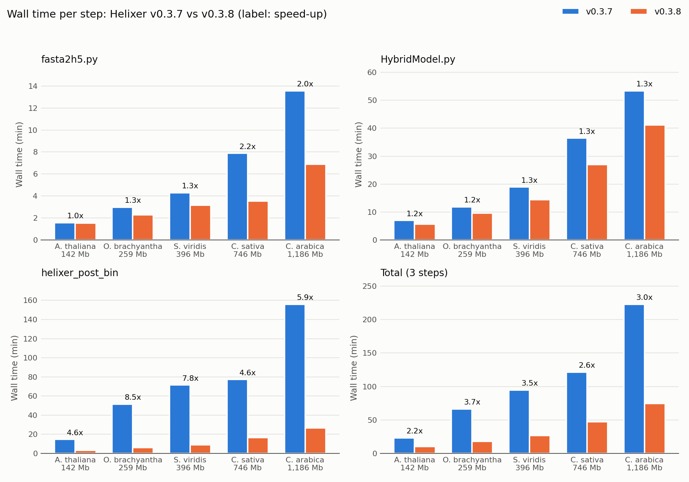
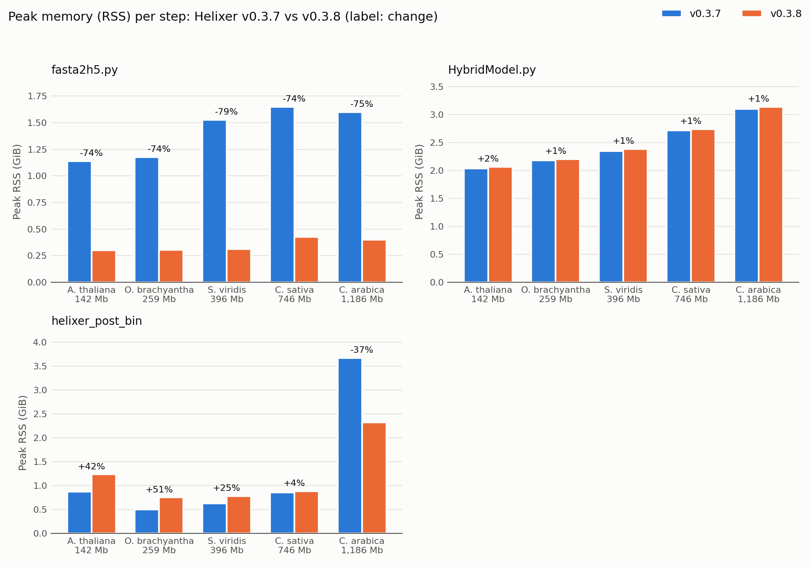
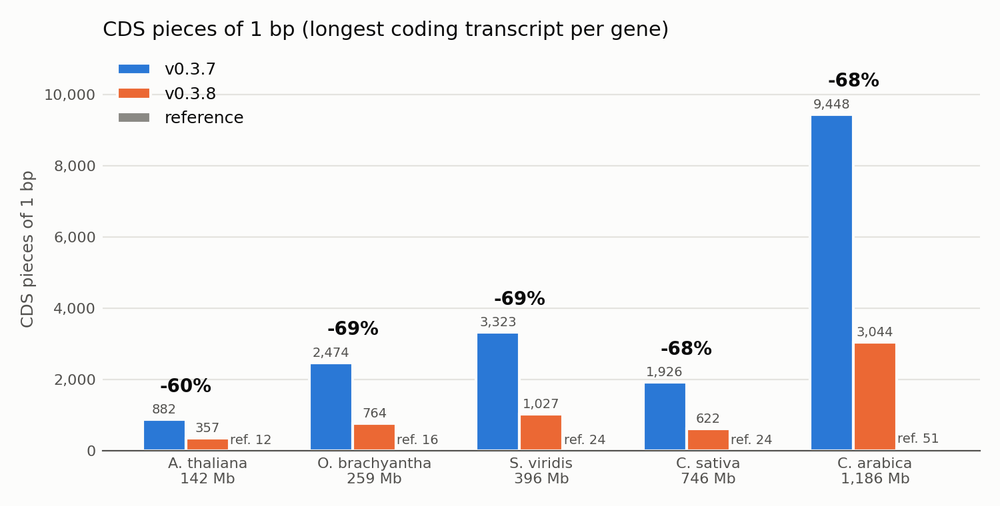

# Performance of Helixer v0.3.8 compared to v0.3.7

Run time, memory use and annotation quality of the 3-step method (`fasta2h5.py`,
`HybridModel.py`, `helixer_post_bin`) of Helixer v0.3.7 and v0.3.8 on five plant
genomes, one run per version and genome.

## Table of Contents
1. [Genomes](#genomes)
2. [Hardware and software](#hardware-and-software)
3. [Settings](#settings)
4. [Speed](#speed)
5. [Memory](#memory)
6. [Annotation quality](#annotation-quality)

## Genomes
Only the assembled nuclear chromosomes are annotated: sequences whose FASTA
header names an organelle or an unplaced or unlocalized scaffold are removed
from the genome and the reference annotation beforehand.

| Species                | Assembly                                   |                                  Chromosomes | Chromosome accessions     | Size (Mb) | Land plant model             |
|:-----------------------|:-------------------------------------------|---------------------------------------------:|:--------------------------|----------:|:-----------------------------|
| *Arabidopsis thaliana* | TAIR12, GCA_978657495.1                    |                                            5 | OZ408683.1 - OZ408687.1   |     142.5 | training species (as TAIR10) |
| *Oryza brachyantha*    | ObraRS2, GCF_000231095.2                   |                                           12 | NC_023163.2 - NC_023174.2 |     258.9 | held out                     |
| *Setaria viridis*      | Setaria_viridis_v4.0, GCF_005286985.2      |                                            9 | NC_048263.2 - NC_048271.2 |     396.4 | held out                     |
| *Cannabis sativa*      | ASM2916894v1, GCF_029168945.1              |                                           10 | NC_083601.1 - NC_083610.1 |     745.9 | held out                     |
| *Coffea arabica*       | Coffea_Arabica_ET-39_HiFi, GCF_036785885.1 | 22 (11 per subgenome, 1c - 11c and 1e - 11e) | NC_092310.1 - NC_092331.1 |   1,185.7 | held out                     |

The training and validation species of the land plant model are listed in the
[model overview](model_overview.md).

## Hardware and software
| Step                              | Hardware                                                                                                                    |
|:----------------------------------|:----------------------------------------------------------------------------------------------------------------------------|
| `fasta2h5.py`, `helixer_post_bin` | Intel Xeon E5-2690 v4 @ 2.60 GHz, 56 hardware threads, 251 GB RAM, Ubuntu 22.04; all CPU runs on two nodes of the same type |
| `HybridModel.py`                  | NVIDIA RTX PRO 6000 Blackwell Server Edition (96 GB), AMD EPYC 9135 16-core CPU                                             |

TensorFlow 2.15.1 has no precompiled kernels for the compute capability 12.0 of
the Blackwell GPU, so both versions compile them at the start of each
`HybridModel.py` run.

| Software    | v0.3.7                                                                | v0.3.8                 |
|:------------|:----------------------------------------------------------------------|:-----------------------|
| Helixer     | 0.3.7                                                                 | 0.3.8 (commit b974b6e) |
| GeenuFF     | 0.3.2                                                                 | 0.4.0                  |
| HelixerPost | last commit of the main branch (as of 20th of November 2026), 6f8ab1c | 0.4.0                  |
| TensorFlow  | 2.15.1                                                                | 2.15.1                 |
| Python      | 3.10.12                                                               | 3.10.12                |

Evaluation: GeenuFF 0.4.0 (`filter_longest_transcripts.py` for the reference
GFF3 files), GffCompare 0.12.10, GffRead 0.12.7, BUSCO 6.0.0. The only thing
that changed in Helixer/HelixerPost after this evaluation are
cosmetic/docs changes; none affect the results.

## Settings
Both versions use the land plant model `land_plant_v0.3_a_0080.h5` with the
parameters `Helixer.py` sets for it, and the defaults of their version
otherwise. Shared by both versions:

- `fasta2h5.py`: `--subsequence-length 64152`, 1 CPU core
- `HybridModel.py`: `--overlap --overlap-offset 32076 --core-length 48114
  --val-test-batch-size 32`, gzip compression of the predictions, 1 GPU and
  1 CPU core
- `helixer_post_bin`: window size 100, edge threshold 0.1, peak threshold 0.8,
  minimum coding length 60, 4 CPU cores

Differences:

| Step               | Setting                        | v0.3.7                                                                                                 | v0.3.8                                                               |
|:-------------------|:-------------------------------|:-------------------------------------------------------------------------------------------------------|:---------------------------------------------------------------------|
| `fasta2h5.py`      | processes                      | 1 (`--no-multiprocess`; by default it forks up to CPU count - 1 processes, which is oftentimes slower) | 1 (no multiprocessing)                                               |
| `HybridModel.py`   | compression of the predictions | in the main thread                                                                                     | in 4 threads (`--compression-threads` default)                       |
| `helixer_post_bin` | donor penalties (all three)    | 0 (hardcoded)                                                                                          | 20                                                                   |
| `helixer_post_bin` | HMM donor/acceptor weight      | 1                                                                                                      | 2                                                                    |
| `helixer_post_bin` | threads                        | 1 (no threads option before HelixerPost 0.4.0)                                                         | 4 (`--threads 4 --max-in-flight-mbp 4`, as `Helixer.py` passes them) |

Wall time and peak resident memory (RSS) of each step were measured with GNU
time (`/usr/bin/time -v`), the GPU memory with `nvidia-smi` every 10 s.
The HybridModel.py job requested one CPU on SGE to avoid GPU selection issues;
on average 90 to 95% CPU used by v0.3.7, 113 to 126% by v0.3.8; short spikes
weren't measured.

## Speed

Over all three steps, v0.3.8 annotated the genomes 2.2 to 3.7 times faster than
v0.3.7, e.g. *C. arabica* in 75 instead of 223 minutes. Most of the gain comes
from `helixer_post_bin` (4.6 to 8.5 times faster), followed by `fasta2h5.py`
(1.0 to 2.2 times, more on the larger genomes) and `HybridModel.py` (1.2 to 1.3
times).

## Memory

`fasta2h5.py` of v0.3.8 needed 74 to 79% less memory (0.30 to 0.43 GiB instead
of 1.14 to 1.65 GiB), while `HybridModel.py` used the same in both versions (2.0
to 3.1 GiB RAM, 17,211 MiB GPU memory in every run). `helixer_post_bin` of
v0.3.8 with 4 threads used 4 to 51% more memory on the four smaller genomes (at
most 1.24 GiB) but 37% less on *C. arabica* (2.32 instead of 3.67 GiB), so the
peak of a whole v0.3.8 run is set by `HybridModel.py`.

### Virtual memory v0.3.8
The virtual memory (address space) is for `HybridModel.py` far above its
resident memory: TensorFlow and CUDA reserve 22 to 30 GiB of address space
(mainly depending on the GPU and the node), and the GPU memory TensorFlow
allocates is mapped into the address space as well. The peak virtual memory of
v0.3.8 (VmPeak in `/proc/<pid>/status`, read every 0.1 s, on *A. thaliana* and
*C. arabica*, i.e. the smallest and largest genome in this test respectively)
was 39.3 to 40.4 GiB for `HybridModel.py`, 2.5 to 2.6 GiB for `fasta2h5.py` and
1.3 to 2.2 GiB for `helixer_post_bin` (4 threads). GPU jobs with the land plant
model, a subsequence length of 64,152 bp and batch size 32 therefore need about
50 GiB of virtual memory. The requirement grows with the GPU memory used, which
depends on the subsequence length, the batch size and the model; the GPU matters
as well (batch size 32 in all runs):

| Model (subsequence length) | Genome                 | GPU                    | Peak virtual memory (GiB) | GPU memory (GiB) | Rest (GiB) | After loading the model (GiB) |
|:---------------------------|:-----------------------|:-----------------------|--------------------------:|-----------------:|-----------:|------------------------------:|
| land plant (64,152 bp)     | *A. thaliana*          | RTX PRO 6000 Blackwell |                      39.3 |             16.8 |       22.5 |                          19.3 |
| land plant (64,152 bp)     | *C. arabica*           | RTX PRO 6000 Blackwell |                      40.4 |             16.8 |       23.6 |                          19.3 |
| land plant (64,152 bp)     | *A. thaliana*          | Quadro RTX 8000        |                      44.8 |             16.3 |       28.5 |                          21.3 |
| vertebrate (213,840 bp)    | chromosome 1 of GRCh38 | Quadro RTX 8000        |                      62.7 |             32.7 |       30.0 |                          21.3 |

GPU memory: the largest value of `nvidia-smi`, read every 10 s. Rest: the peak
virtual memory minus the GPU memory, i.e. the address space of TensorFlow, CUDA
and the data on the host. After loading the model: the virtual memory once the
model is loaded, before the first batch is predicted, which does not depend on
the input data or the model. The rest mostly depends on the GPU and the node:
with the same model and genome, it is about 6 GiB larger on the Quadro RTX 8000
than on the RTX PRO 6000 Blackwell. On the same GPU, the vertebrate model with
its longer subsequences adds only about 1.5 GiB.

`HybridModel.py` of v0.3.7 (same TensorFlow version, compression in the main
thread) used the same memory as v0.3.8 with 4 compression threads
(*A. thaliana*, Quadro RTX 8000): 44.8 GiB virtual memory, 2.1 GiB RAM and
16.3 GiB GPU memory.

## Annotation quality
The predictions of both versions and the reference annotation are reduced to the
longest coding transcript per gene (Helixer already only predicts the longest
isoform anyway) with only its CDS lines (GeenuFF's
`filter_longest_transcripts.py --no-utrs`). With one transcript per gene, the
transcript level of GffCompare equals its gene (locus) level.

### CDS pieces of 1 bp
Most CDS pieces of 1 bp come from the post-processing: where the reading frame
(phase) Helixer predicts for the exons on both sides of an intron is shifted by
one base, HelixerPost repairs it with an extra exon of 1 bp between two introns
(62.2% of the 12,656 internal CDS pieces of 1 bp of v0.3.7 in the five genomes,
75.5% of 4,819 in v0.3.8). The neural network itself hardly predicts these
bases as coding: it predicts no phase at the 1 bp base at 98.1% (v0.3.7) and
98.9% (v0.3.8) of them, with a median CDS probability of 0.019 and 0.013.

CDS pieces of 1 bp are counted in the longest coding transcript per gene.

v0.3.8 predicts 60 to 69% fewer CDS pieces of 1 bp than v0.3.7 (e.g. 3,044
instead of 9,448 in *C. arabica*), though still more than the reference
annotations contain (12 to 51).

Fewer CDS pieces of 1 bp can be predicted with higher donor penalties
(`hmm.donor_fixed_penalty`, default 20) and donor/acceptor weights
(`hmm.weights`, default 2) in a `--post-config-path` file (template:
`helixer_post_bin --print-default-config`). In tests on further genomes, higher
values removed more CDS pieces of 1 bp and slightly raised the exon and intron
F1, but split more genes at introns that RNA-seq reads show to belong to one
transcript and very slightly lowered the share of proteins OMArk finds consistent
with the lineage (more fragmented proteins and more of unknown origin), so the
defaults are a carefully chosen compromise.

### BUSCO
Proteins of all predicted transcripts (`gffread -y`) scored with BUSCO 6.0.0 in
protein mode against the most specific odb12 lineage available for each species;
complete and missing BUSCOs in percent.

| Genome                      | Lineage (BUSCOs)       | Complete v0.3.7 | Complete v0.3.8 | Change | Missing v0.3.7 | Missing v0.3.8 | Change |
|:----------------------------|:-----------------------|----------------:|----------------:|-------:|---------------:|---------------:|-------:|
| Arabidopsis thaliana TAIR12 | brassicales (4,311)    |            99.2 |            99.3 |   +0.1 |            0.6 |            0.6 |   +0.0 |
| Oryza brachyantha           | poales (6,282)         |            98.4 |            98.4 |   +0.0 |            0.8 |            0.8 |   +0.0 |
| Setaria viridis             | poales (6,282)         |            98.8 |            99.0 |   +0.2 |            0.4 |            0.3 |   -0.1 |
| Cannabis sativa             | rosales (9,329)        |            95.1 |            95.2 |   +0.1 |            4.2 |            4.1 |   -0.1 |
| Coffea arabica              | eudicotyledons (2,805) |            97.4 |            97.6 |   +0.2 |            0.6 |            0.5 |   -0.1 |

Completeness rises by at most 0.2 and missing BUSCOs fall by at most 0.1
percentage points, so the BUSCO scores of both versions are nearly the
same.

### GffCompare
GffCompare 0.12.10 compares the predictions with the reference (both the longest
coding transcript per gene, CDS only); recall is GffCompare's sensitivity, F1 =
2 x recall x precision / (recall + precision), all in percent. The numbers of
compared genes are the reference and query transcripts GffCompare reports:

| Genome                          | Reference | v0.3.7 | v0.3.8 |
|:--------------------------------|----------:|-------:|-------:|
| Arabidopsis thaliana TAIR12     |    26,866 | 27,239 | 27,497 |
| Oryza brachyantha               |    23,230 | 27,338 | 27,852 |
| Setaria viridis                 |    27,456 | 35,207 | 36,175 |
| Cannabis sativa                 |    27,923 | 24,381 | 24,712 |
| Coffea arabica (two subgenomes) |    50,007 | 58,081 | 59,274 |

GffCompare merges reference genes with identical CDS into one (e.g. one pair in
*A. thaliana*), so it counts one gene less than the filtered reference (26,867
for *A. thaliana*).

| Genome                      | Level             | Recall v0.3.7 | Precision v0.3.7 | F1 v0.3.7 | Recall v0.3.8 | Precision v0.3.8 | F1 v0.3.8 | F1 change |
|:----------------------------|:------------------|--------------:|-----------------:|----------:|--------------:|-----------------:|----------:|----------:|
| Arabidopsis thaliana TAIR12 | Base              |          95.8 |             95.2 |  **95.5** |          95.9 |             95.0 |      95.4 |      -0.1 |
| Arabidopsis thaliana TAIR12 | Exon              |          91.3 |             88.2 |      89.7 |          91.6 |             89.1 |  **90.3** |      +0.6 |
| Arabidopsis thaliana TAIR12 | Intron            |          93.3 |             89.7 |      91.5 |          93.8 |             91.1 |  **92.4** |      +1.0 |
| Arabidopsis thaliana TAIR12 | Intron chain      |          69.8 |             68.5 |      69.1 |          72.0 |             70.6 |  **71.3** |      +2.1 |
| Arabidopsis thaliana TAIR12 | Gene (transcript) |          72.8 |             71.8 |      72.3 |          74.6 |             72.9 |  **73.7** |      +1.4 |
| Oryza brachyantha           | Base              |          97.1 |             90.8 |  **93.8** |          97.3 |             90.3 |      93.7 |      -0.2 |
| Oryza brachyantha           | Exon              |          91.2 |             81.8 |      86.2 |          91.4 |             83.8 |  **87.4** |      +1.2 |
| Oryza brachyantha           | Intron            |          91.0 |             82.6 |      86.6 |          92.1 |             86.3 |  **89.1** |      +2.5 |
| Oryza brachyantha           | Intron chain      |          63.8 |             56.3 |      59.8 |          68.0 |             59.6 |  **63.5** |      +3.7 |
| Oryza brachyantha           | Gene (transcript) |          69.9 |             59.4 |      64.2 |          73.2 |             61.1 |  **66.6** |      +2.4 |
| Setaria viridis             | Base              |          94.6 |             85.8 |  **90.0** |          94.8 |             84.8 |      89.5 |      -0.5 |
| Setaria viridis             | Exon              |          89.9 |             74.7 |      81.6 |          90.2 |             76.6 |  **82.8** |      +1.2 |
| Setaria viridis             | Intron            |          90.6 |             76.5 |      83.0 |          91.7 |             80.1 |  **85.5** |      +2.6 |
| Setaria viridis             | Intron chain      |          63.5 |             50.4 |      56.2 |          67.2 |             52.8 |  **59.1** |      +2.9 |
| Setaria viridis             | Gene (transcript) |          68.2 |             53.2 |      59.8 |          71.1 |             53.9 |  **61.3** |      +1.5 |
| Cannabis sativa             | Base              |          76.8 |             90.7 |  **83.2** |          77.0 |             90.1 |      83.0 |      -0.1 |
| Cannabis sativa             | Exon              |          80.3 |             82.7 |      81.5 |          80.6 |             84.4 |  **82.5** |      +1.0 |
| Cannabis sativa             | Intron            |          84.0 |             84.3 |      84.1 |          84.8 |             87.1 |  **85.9** |      +1.8 |
| Cannabis sativa             | Intron chain      |          51.5 |             59.0 |      55.0 |          54.3 |             62.1 |  **57.9** |      +2.9 |
| Cannabis sativa             | Gene (transcript) |          53.1 |             60.8 |      56.7 |          55.3 |             62.5 |  **58.7** |      +2.0 |
| Coffea arabica              | Base              |          83.4 |             83.9 |  **83.6** |          83.7 |             83.2 |      83.4 |      -0.2 |
| Coffea arabica              | Exon              |          83.1 |             69.2 |      75.5 |          83.5 |             72.6 |  **77.7** |      +2.2 |
| Coffea arabica              | Intron            |          82.6 |             68.1 |      74.7 |          84.4 |             73.9 |  **78.8** |      +4.1 |
| Coffea arabica              | Intron chain      |          45.4 |             39.4 |      42.2 |          50.1 |             43.4 |  **46.5** |      +4.3 |
| Coffea arabica              | Gene (transcript) |          50.3 |             43.3 |      46.5 |          54.1 |             45.6 |  **49.5** |      +2.9 |

F1 rises in v0.3.8 at every level above single bases, most at the intron (+1.0
to +4.1) and intron chain (+2.1 to +4.3) levels and least for *A. thaliana*,
while the base level changes by at most 0.5 points.
